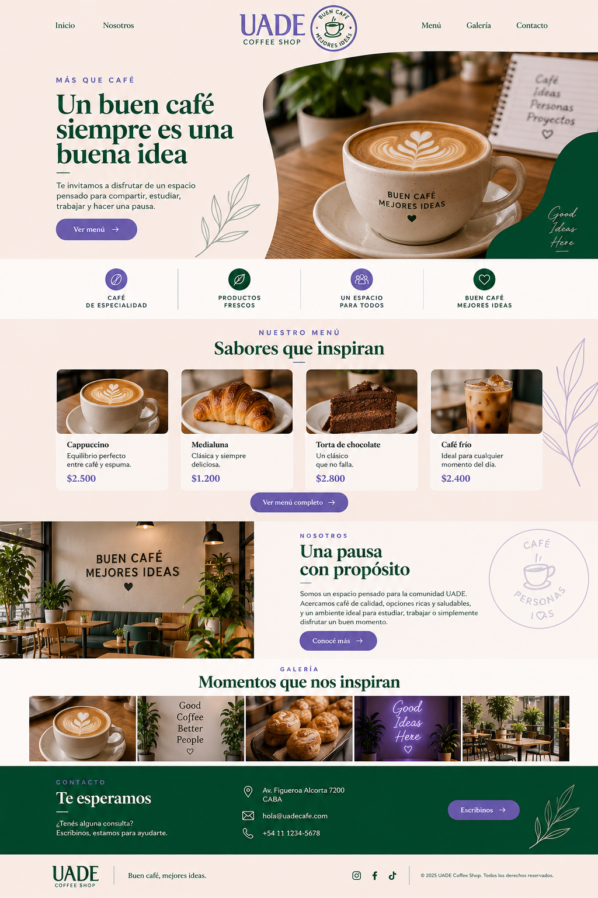

# UADE Coffee Shop

## Descripción

UADE Coffee Shop es un sitio web one-page desarrollado como catálogo de productos para una cafetería ficticia orientada a la comunidad UADE.

El sitio presenta información sobre la cafetería, sus principales productos, una galería de imágenes y medios de contacto.

## Estructura del sitio

El sitio está compuesto por las siguientes secciones:

- Inicio / Hero
- Menú
- Nosotros
- Galería
- Contacto
- Footer

La navegación se realiza dentro de la misma página mediante enlaces internos.

## Paleta de colores

Los principales colores utilizados son:

- Verde: #004629
- Violeta: #6D5EB5
- Beige: #F9ECE5
- Blanco: #FFFFFF

## Tipografías

- Playfair Display
- Mulish

Las tipografías utilizadas fueron obtenidas de Google Fonts.

## Tecnologías utilizadas

- HTML5
- CSS3
- Flexbox

## Mockup

Para el desarrollo del sitio se realizó previamente un mockup utilizado como referencia para definir la estructura, distribución de los elementos, paleta de colores y estilo visual.

## Integrantes

- Irina Puskovas
- Pedro Zarza